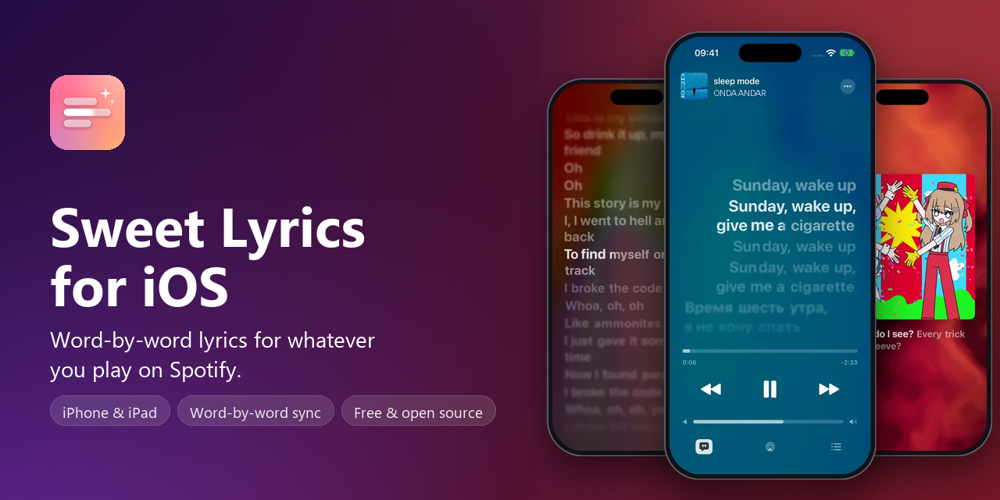
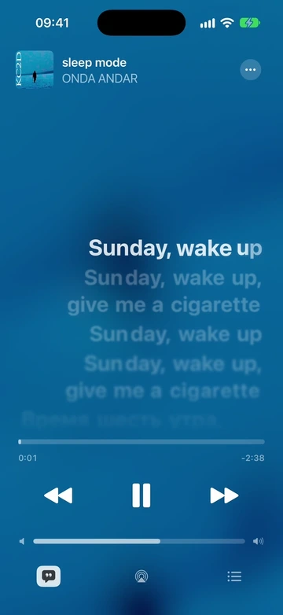
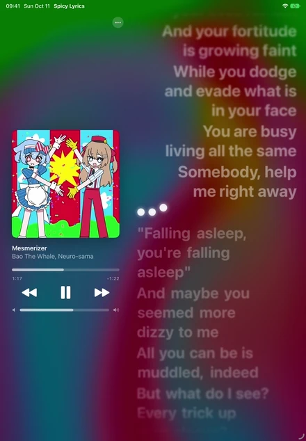

<p align="center"></p>

# Sweet Lyrics for iOS

**Word-by-word lyrics for whatever you're playing on Spotify**, in an Apple Music style
player on your iPhone or iPad.

It's an unofficial iOS version of [Spicy Lyrics](https://github.com/Spikerko/spicy-lyrics),
the popular Spicetify extension for Spotify on desktop. Made by
**[sppq](https://spicylyrics.org/sppq)** ([GitHub](https://github.com/Sppqq)), tested by
**[nie4ick](https://spicylyrics.org/nie4ick)**.

> **Heads up: it works, but it's still early.** You can use it every day, but expect some bugs
> and settings that change between versions. If something breaks, please
> [tell us](https://github.com/Sppqq/sweet-lyrics-ios/issues).

<p align="center">
  
  
  
</p>
<p align="center"><sub>Lyrics light up word by word · duets, each singer on their own side · the player</sub></p>

<p align="center">
  
</p>
<p align="center"><sub>Turn your phone sideways</sub></p>

<p align="center">
  
  
</p>
<p align="center"><sub>iPad · lyrics on your TV, with your phone as the remote</sub></p>

<p align="center">
  
  
  
</p>
<p align="center"><sub>Your own look · lyrics in Latin letters · big artwork mode</sub></p>

<p align="center">
  
  
  
</p>
<p align="center"><sub>Simple Lyrics Mode · queue · settings</sub></p>

## What it can do

- **Choose Spotify or Apple Music** (the iOS Music system player); optional crossfade / AutoMix lyric transitions.
- **Lyrics that follow the singer word by word**, with the same smooth animations as the desktop
  extension. In duets each singer gets their own side, backing vocals sit under the main line,
  and instrumental breaks show three bouncing dots.
- **Tap a line to jump to it.** Swipe sideways to change songs, pinch to make the text bigger,
  long-press a line to copy or share it (swipe and pinch need iOS 18).
- **A background made from the album cover** that slowly flows like liquid.
- **Big artwork mode**: the quote button at the bottom left swaps the lyrics for a large cover
  with the current line under it.
- **Lyrics on your TV**: turn on Screen Mirroring (AirPlay) or plug in a display, and it shows
  full-screen lyrics like the desktop extension, while your phone stays the remote.
- **Floating lyrics (Picture in Picture)**: keep the current line on screen over other apps.
- **Lyrics in other languages**: Japanese, Chinese, Korean, Russian and Greek can be shown in
  Latin letters, and any song can be translated line by line.
- **Make it yours**: font, size, boldness, alignment, glow, blur and background, all in Settings.
- **Pick what plays next** from your queue or history, or search for a song.
- **Skip songs without synced lyrics**, if you want.
- **Your own lyrics**: add a TTML file for a song that has none.
- **iPad**, upright and sideways, with keyboard shortcuts.
- In **English and Russian**.

## What you need

- An **iPhone or iPad** on **iOS 17** or newer.
- **Spotify Premium** for Spotify mode, or **Music library permission** for Apple Music mode (no Spotify Client ID required).
- A **Windows PC or Mac** to set up AltStore or SideStore (see below). With SideStore that is needed
  once; AltStore keeps needing the computer (AltServer) to refresh the app.

## How to install

The app isn't on the App Store, so you install it with **AltStore** or **SideStore**. These are
free apps that install apps from outside the App Store using your own Apple ID.

**1. Get AltStore or SideStore on your phone.** Pick one and follow its guide:
- [AltStore](https://altstore.io): uses a small helper program on your computer.
- [SideStore](https://sidestore.io): after the first setup, works on the phone alone.

**2. Add Sweet Lyrics to it.** Copy this link:

```
https://github.com/Sppqq/sweet-lyrics-ios/releases/latest/download/altstore-source.json
```

In AltStore or SideStore go to **Sources → +**, paste the link and tap **Add**.

<details>
<summary>Want new features first? Use the test channel instead</summary>

```
https://github.com/Sppqq/sweet-lyrics-ios/releases/latest/download/altstore-source-testing.json
```

You get every new build as soon as it's made, so it can be buggier. Add only **one** of the two
links: they install the same app.
</details>

**3. Install it.** Open the source, tap **Sweet Lyrics → Install** and wait a moment.

**4. Connect Spotify.** Open the app and follow its guide. It takes about two minutes;
[here's why it's needed](#why-do-i-have-to-create-a-spotify-app).

**Updates** show up in AltStore or SideStore under **My Apps**. Your settings stay when you update.

## Questions and problems

### Why do I have to create a Spotify app?

Spotify lets each developer app be used by only **5 people**. So instead of sharing one app,
everybody makes their own. It's free and takes a couple of minutes. The app walks you
through it, and here are the same steps:

1. Open the [Spotify Developer Dashboard](https://developer.spotify.com/dashboard), sign in with
   your Spotify account and accept the terms.
2. Tap **Create app**. Give it any name and description. Under **Redirect URIs** type
   `spicylyrics-ios://callback` and press **Add**. Tick **Web API**, accept, and **Save**.
3. Open **Settings → User Management** and add the email of your Spotify account.
   You can add up to 5 people there, so friends can use your app too.
4. Copy the **Client ID** from **Basic Information** and paste it into Sweet Lyrics.

### The lyrics are a bit behind or ahead

For the most exact timing, let Sweet Lyrics talk to the Spotify app on the same phone:

1. In your app on the [Spotify Developer Dashboard](https://developer.spotify.com/dashboard),
   open **Settings** and tick **iOS** as well.
2. Add the **Bundle ID** shown in Sweet Lyrics under *Settings → Sync → If it won't connect*,
   and the redirect URI `spicylyrics-ios://callback`.
3. Sign in again in Sweet Lyrics if it asks.

### The app stopped opening after a week

With a free Apple ID, apps you install yourself work for **7 days** and then need a refresh.
AltStore refreshes them on its own when your computer with AltServer is on the same Wi-Fi;
SideStore does it on the phone. To refresh by hand: **My Apps → Refresh All**.
A free Apple ID can have only 3 such apps at a time.

### Other problems

- **"INVALID_CLIENT" or error 403 when signing in**: something in your Spotify app is off.
  Check the Client ID, the redirect URI, and that your email is under User Management.
- **The sync badge says "sign in again"**: sign in again in the app.
- **"no link to Spotify"**: Spotify has to be playing on this phone. Tap the badge →
  *Open Spotify and Connect*.
- **Anything else**: go to *Settings → Log → Share Log File* and
  [open an issue](https://github.com/Sppqq/sweet-lyrics-ios/issues) with the file attached.

### Good to know

- Lyrics follow Spotify while the app is open or the floating lyrics window is on screen.
- Play, pause, skip and jumping to a line need Spotify Premium.
- Lyrics come from Spicy Lyrics, and from [LRCLIB](https://lrclib.net) when Spicy Lyrics has none.

### Can I install it without AltStore?

Yes. Every [release](https://github.com/Sppqq/sweet-lyrics-ios/releases) has an `.ipa` file that
you can sign with another tool, such as [Sideloadly](https://sideloadly.io).

## For developers

How it works inside, how to build it, and how releases are made: [docs/DEVELOPMENT.md](docs/DEVELOPMENT.md).

<sub>The clips above were recorded in the iOS Simulator with the app's demo mode. Songs: Nemo — The Code,
Bao The Whale &amp; Neuro-sama — Mesmerizer, KIDSCRY2DAY — sleep mode.</sub>

## License and credits

- Author: [sppq](https://spicylyrics.org/sppq) · [github.com/Sppqq](https://github.com/Sppqq)
- Tester: [nie4ick](https://spicylyrics.org/nie4ick)
- Original extension: [Spicy Lyrics](https://github.com/Spikerko/spicy-lyrics) by Spikerko
- Inspired by the Android app [spicylyrics/mobile](https://github.com/spicylyrics/mobile)

Licensed under **AGPL-3.0**, like the original projects. See [LICENSE](LICENSE).
This is an unofficial project, not affiliated with Spotify or the creators of Spicy Lyrics.
